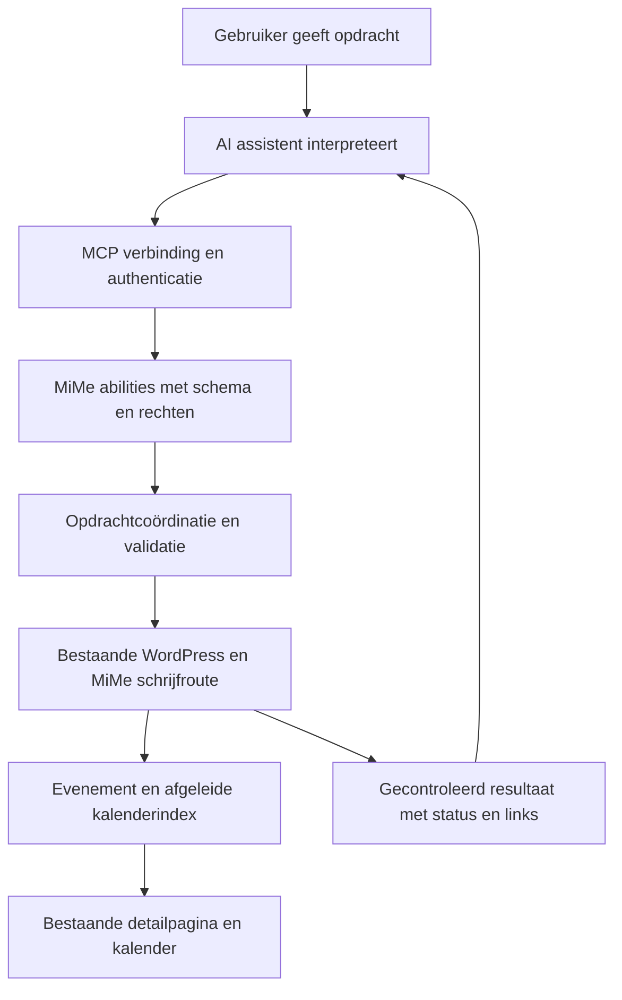

# Functionele en technische analyse van AI en MCP voor MiMe

**Datum:** 14 oktober 2026  
**Status:** ontwerpvoorstel voor toekomstige ontwikkeling  
**Prioriteit:** na kwalificatie van FullCalendar 7, volgens ADR-101  
**Onderzochte basis:** MiMe 0.9.0, hoofdbranch `abdf9f162d581d5154be6d4d043119e7fe02b169`

MiMe kan een AI-assistent in staat stellen evenementen te beheren via gewone
taal. De bestaande WordPress-inhoud, validatie en weergave zijn hiervoor een
bruikbare basis. Het ontbrekende werk zit vooral in een begrensde bedieningslaag,
authenticatie, betrouwbare schrijfopdrachten en een begrijpelijke terugkoppeling.
Alleen een MCP-endpoint toevoegen is onvoldoende voor een betrouwbare integratie.

De aanbevolen eerste oplevering ondersteunt evenementen opzoeken en eenmalige
evenementen als concept aanmaken. Publiceren en complexe wijzigingen volgen na
afzonderlijke kwalificatie. MiMe blijft volledig werken zonder AI, MCP Adapter
of abonnement bij een modelaanbieder. Deze analyse verandert geen pluginwerking.

## Functioneel resultaat

Een gebruiker kan bijvoorbeeld vragen:

> Maak een concept voor onze netwerkavond op 20 november 2026 van 19 tot 22 uur,
> in Antwerpen, met een korte uitnodigende beschrijving.

De assistent haalt eerst de sitecontext op, zet de opdracht om naar concrete
velden en gebruikt de MiMe-functie om een concept te maken. Het antwoord bevat
de opgeslagen titel, datum, tijdzone, conceptstatus en een bewerklink. Als de
naam van de locatie ontbreekt, wordt die niet verzonnen. Een omschrijving mag
worden voorgesteld, maar mag geen ongevraagde prijzen, sponsors of praktische
afspraken als feiten toevoegen.

Een evenement is al een eigen WordPress-inhoudstype met een detailpagina. Er
hoeft dus geen tweede gewone WordPress-pagina naast te worden aangemaakt. Na
publicatie gebruikt het evenement het bestaande thema- of buildersjabloon.
Verschijnen in een specifieke kalender hangt ook af van diens datumvenster,
filters en gekozen categorieën; publicatie garandeert niet iedere plaatsing.

### Betekenis van eventpagina

| Gewenst resultaat | Voorgestelde afbakening |
| --- | --- |
| Evenement met titel, tekst, datum en locatie | Eerste oplevering |
| Bestaande categorieën, tags en uitgelichte afbeelding gebruiken | Eerste oplevering, met rechtencontrole |
| De bestaande detailvormgeving gebruiken | Automatisch via de huidige templatehiërarchie |
| Eenvoudige beschrijving met paragrafen en lijsten | Eerste oplevering, beperkte veilige opmaak |
| Een bestaande concepttekst aanpassen | Na kwalificatie van conflictdetectie |
| Publiceren of een gepubliceerd evenement wijzigen | Volgende fase met afzonderlijk beleid |
| Een volledige Elementor- of Divi-layout ontwerpen | Apart project; niet inbegrepen |
| Nieuwe afbeeldingen genereren of externe afbeeldingen importeren | Apart werkpakket; niet inbegrepen |
| Herhalingen, annuleringen en individuele uitvoeringen wijzigen | Latere fase met expliciete wijzigingsscope |
| Ticketing, deelnemers, betalingen, agenda-import of synchronisatie | Buiten deze integratie |

De AI-assistent verzorgt taalbegrip en eventuele tekstgeneratie. MiMe ontvangt
getypeerde gegevens en voert alleen de toegestane handelingen uit. Een ingebouwde
chatbox, eigen modelhosting, model-API-sleutels en modelkeuze horen niet bij dit
voorstel. Kosten voor de gekozen AI-dienst staan los van de plugin.

### Datums en ontbrekende informatie

- Relatieve taal zoals “volgende vrijdag” wordt door de assistent vertaald naar
  een expliciete datum aan de hand van de actuele sitecontext. De server accepteert
  geen vrije datumzinnen. Bij meerdere redelijke interpretaties volgt een vraag.
- Een datum zonder tijd betekent niet automatisch een hele-dag-evenement.
  Ontbrekende gegevens mogen in een concept blijven ontbreken; publicatie volgt
  de bestaande volledigheidsregels.
- Begin, einde, hele-dag-status en tijdzone worden teruggetoond zoals opgeslagen.
  Een ontbrekend einde volgt de bestaande normalisatie; geen stil verzonnen duur.
- Bestaande evenementen behouden hun opgeslagen tijdzone. Een sitewijziging mag
  bij een tekstaanpassing niet ongemerkt de evenementtijd veranderen.
- Niet-bestaande en dubbelzinnige lokale tijden tijdens de zomertijdwissel blijven
  foutmeldingen. De AI mag geen eigen afwijkende datumregels toepassen.
- Publicatiestatus en evenementstatus blijven afzonderlijk: een gepubliceerd
  evenement kan geannuleerd zijn, en een toekomstig evenement hoeft geen gepland
  WordPress-publicatiebericht te zijn.

## Bestaande basis en ontbrekende onderdelen

| Onderdeel | Gecontroleerde bestaande basis | Benodigd voor AI |
| --- | --- | --- |
| Inhoud | `src/Content/EventPostType.php`: `wpse_event`, REST, revisies, titel, tekst en afbeelding | Benoemde acties met een beperkte invoer- en uitvoerset |
| Datums | `EventInputMapper`, `EventValidator`, `EventPublicationPolicy` | Vertaling van begrijpelijke veldnamen naar hetzelfde contract |
| Opslag | `EventRestController` valideert vóór insert; `EventPersistence` bewaart metadata en activeert projectie via de composition root | Opdrachtresultaat, herhaalbaarheid, foutafhandeling en verificatie van de volledige schrijfoperatie |
| Rechten | `src/Access/EventCapabilities.php`, objectgebonden `edit_post` en metaauthorisatie | Opt-in voor AI en aanvullende actiebeperkingen bovenop bestaande rechten |
| Herhaling | `RecurrenceEditorService` met preview, revisie, getekende bevestiging en savecoördinatie | Later een dunne adapter met expliciete scope; geen nieuwe recurrence-engine |
| Dupliceren | `src/Admin/EventDuplicator.php` en allowlist in het duplicatieplan | Later een autoriserende wrapper; de service zelf neemt de controllercontroles niet over |
| Presentatie | Native templates, Gutenberg en optionele builderintegraties | Bestaande templates hergebruiken en builderinhoud beschermen |
| Beveiliging | `SECURITY-PERMISSION-MATRIX.md`, publieke filters, tests | Nieuwe geauthenticeerde mogelijkheden en hun grenzen expliciet vastleggen |
| MCP | Geen registratie of adapter in de onderzochte plugin | Abilities-registratie, verbinding, versiebeleid en tests |

De huidige opslagklasse is geen algemene create/update-transactie voor alle
WordPress-velden, termen en media. Metadata, postinhoud en afgeleide indexen
kunnen in verschillende stappen veranderen. Daarom mag een nieuwe wrapper niet
zonder bewijs claimen dat elke mislukte opdracht nul wijzigingen achterlaat.
Ook een gewone WordPress-revisie is geen complete rollback voor alle relaties,
termen en externe hooks. Dit zijn te kwalificeren grenzen, geen aangetoonde
nieuwe kwetsbaarheden van de huidige plugin.

## Architectuurvoorstel

De WordPress Abilities API is beschikbaar vanaf WordPress 6.9, de huidige
minimumversie van MiMe. Daarmee kunnen plugins benoemde functies met invoer,
uitvoer en rechten registreren. De officiële MCP Adapter verbindt dergelijke
functies met MCP-clients. [Abilities API](https://developer.wordpress.org/apis/abilities-api/),
[MCP Adapter](https://github.com/WordPress/mcp-adapter).

FullCalendar blijft uitsluitend bij de weergave betrokken. MCP schrijft geen
FullCalendar-objecten, browserstatus of HTML in de kalender. De migratie naar
FullCalendar 7 is dus een gekozen onderhoudsvolgorde, geen technische voorwaarde
voor MCP. Dit voorkomt dat een latere kalenderupgrade de AI-opdrachten breekt.

### Vergelijking van implementatieroutes

| Route | Voordeel | Nadeel | Advies |
| --- | --- | --- | --- |
| Algemene WordPress REST-tools aan de AI geven | Snel voor een experiment | AI moet metavelden kennen; brede toegang; datumbetekenis en herstel ontbreken | Alleen referentie voor een ontwikkelproef |
| MiMe-abilities met officiële MCP Adapter | Domeingerichte acties; WordPress-standaard; bestaande logica herbruikbaar | Nieuwe actiecontracten en adaptercompatibiliteit testen | Aanbevolen |
| Zelf een volledige MCP-server in MiMe bouwen | Volledige controle | Eigen transport-, protocol- en authenticatieonderhoud | Vermijden |
| Losse MiMe AI-addon | Afzonderlijke releasecyclus | Extra installatie en compatibiliteitsmatrix | Alternatief als de module groot wordt |

Voorkeur: een kleine optionele abilities-module in MiMe; de officiële MCP Adapter
blijft een apart te installeren integratieonderdeel. Geen bundeling van een
model-SDK of tweede MCP-runtime. Ontbrekende of niet-ondersteunde integraties
laten de gewone plugin ongemoeid en geven alleen in de optionele instellingen
uitleg. Geen automatische installatie of activatie van andere plugins.

Voor invoering worden de exacte ondersteunde Adapter-versies vastgezet en de
licentie, onderhoudsstatus en verwijderingskosten vastgelegd. De officiële
repository vermeldt GPL-2.0-or-later. Verwijderen van de koppeling moet alleen
de AI-toegang en tijdelijke opdrachtgegevens wegnemen; evenementen blijven
normale WordPress-inhoud. [MCP Adapter](https://github.com/WordPress/mcp-adapter).

### Aansluiting op de code

Voorgestelde nieuwe verantwoordelijkheden onder `src/Abilities/`: registratie,
strikte schemas, invoermapping, rechtenbeleid en beperkte antwoordserialisatie.
Onder `src/Application/` komt alleen de benodigde opdrachtcoördinatie voor
herhaalbaarheid, conflicten en geverifieerde resultaten. Concrete klassennamen
zijn nog geen publiek contract. Hooks blijven expliciet in `Plugin` geregistreerd.

Voor eenmalige evenementen verdient intern aanroepen van de bestaande core
REST-route via `rest_do_request()` een eerste proef. Dat kan schema-, capability-
en bestaande MiMe REST-hooks behouden zonder een HTTP-verzoek naar de eigen
site. Het is geen nieuwe authenticatielaag: de buitenste verbinding moet de
gebruiker al betrouwbaar hebben vastgesteld. Een callback rechtstreeks op de
REST-controller aanroepen zou controles kunnen overslaan en is geen alternatief.

De proef moet route-initialisatie, de actuele gebruikerscontext, permission
callbacks, alle save-hooks, revisies en de geïnjecteerde occurrence-projector
bewijzen. Alleen als die route onvoldoende betrouwbaar blijkt, wordt een gedeelde
applicatieservice uitgehaald voor zowel REST als abilities. Geen tweede
implementatie van datumvalidatie of handmatige reeks losse `update_post_meta()`-
aanroepen in iedere AI-tool. Recurrence gebruikt later de bestaande editorservice.

## Voorgesteld actiecontract

De namen hieronder zijn ontwerpvoorstellen voor WordPress-abilities. Het
voorvoegsel `wpse_` volgt de repositoryregels. De MCP-naam kan via de adapter
anders worden weergegeven; het definitieve contract krijgt eigen versietests.

| Ability | Invoer en resultaat | Eerste beschikbaarheid |
| --- | --- | --- |
| `wpse_events/get-context` | Site-identiteit, tijdzone, actuele tijd, ondersteunde acties, grenzen en rechten | Pilot |
| `wpse_events/search-events` | Begrensde filters en paginering; samenvattingen met exacte IDs | Pilot |
| `wpse_events/get-event` | Exact evenement-ID; alleen toegestane velden en versiefingerprint | Pilot |
| `wpse_events/list-terms` | Alleen eventcategorieën en eventtags, begrensd | Pilot |
| `wpse_events/create-draft` | Eenmalig evenement en idempotentiesleutel; ID, conceptstatus en bewerklink | Pilot |
| `wpse_events/update-draft` | Exact ID, expliciete veldwijzigingen en verwachte versie | Na concurrency-gate |
| `wpse_events/publish-event` | Exact concept en actuele versie, publicatiebeleid | Fase 2 |
| `wpse_events/update-event` | Voorstel voor bestaand publiek evenement met wijzigingssamenvatting | Fase 2 |
| `wpse_events/preview-recurrence` en `apply-recurrence` | Exacte reeks, scope, revisie en previewbewijs | Fase 3 |

Een voorstel voor `create-draft` gebruikt begrijpelijke velden zoals `title`,
`description`, `start_local`, `end_local`, `timezone`, `all_day`, `venue`,
`address`, `category_ids`, `tag_ids` en `featured_media_id`. Alleen expliciet
ondersteunde velden zijn toegestaan. De server bezit post type, auteurstoewijzing,
UTC-indexen, interne metadata en opdrachtstatus. Geen vrije `meta`-dictionary,
SQL, PHP, bestandsnamen of willekeurige REST-route als argument.

Begin met één evenement per schrijfopdracht. Voorgestelde nieuwe limieten zijn
20 zoekresultaten standaard, maximaal 50, een invoerlimiet van 64 KiB en maximaal
20 term-IDs per taxonomie. Dit zijn te testen ontwerpwaarden; bestaande strengere
productlimieten blijven gelden. Zoekopdrachten leveren standaard samenvattingen,
geen volledige beschrijvingen van alle evenementen. Een interne editorzoekfunctie
is geen toevoeging van publieke full-text kalenderzoekfunctionaliteit.

Bij updates betekent weggelaten “behouden”. Wissen vereist een expliciete,
veldgebonden lege waarde volgens het schema. Alleen veilige tekst of een beperkte
set core-blokken is toegestaan; geen scripts, iframes, uitvoerbare shortcodes of
buildermetadata. Een document met individuele builderinhoud wordt niet stil
overschreven. Bestaande afbeeldingen worden uitsluitend via een toegestaan
attachment-ID gekoppeld; de server downloadt geen door het model opgegeven URL.

Een resultaat vermeldt minimaal actie-ID, evenement-ID, opgeslagen status,
opgeslagen datumwaarden, versie, bewerklink en eventuele waarschuwingen. Een
conceptlink is geen publiek toegankelijke pagina. Fouten krijgen stabiele codes
voor ongeldige velden, onvoldoende rechten, conflict, onbekende uitkomst en
tijdelijke storing. De assistent mag alleen “aangemaakt” of “gepubliceerd” melden
als het resultaat dat daadwerkelijk bevestigt.

## Verbinding en toegangsrechten

Er zijn verschillende aansluitprofielen; die moeten afzonderlijk werken voordat
de integratie als ondersteund wordt aangeboden.

| Profiel | Gebruik | Voorwaarden en beperkingen |
| --- | --- | --- |
| Lokale STDIO via WP-CLI | Ontwikkelproef op een testsite | Lokale WordPress-toegang en expliciete gebruiker; niet automatisch beheerdersrechten |
| HTTPS met Application Password | Beperkte pilot met een geschikte client of vertrouwde bridge | Apart account, geheime opslag, intrekbaarheid; ondersteuning van die authenticatie expliciet testen |
| Remote MCP met OAuth | Gebruiksvriendelijke verbinding voor geschikte externe clients | Apart gekwalificeerde OAuth-infrastructuur, discovery en tokencontrole nodig |

De Adapter documenteert WP-CLI/STDIO en HTTP-verbindingen. WordPress ondersteunt
Application Passwords voor REST via HTTPS. Dat is niet hetzelfde als het
OAuth-profiel van MCP en bewijst geen universele compatibiliteit met iedere
AI-app. Voor een verbinding die het MCP-autorisatieprofiel gebruikt, moeten
onder meer resource-discovery, OAuth 2.1, PKCE en token-audiencevalidatie correct
zijn. MiMe gaat niet zelf een OAuth-server bouwen.
[Adapter CLI](https://raw.githubusercontent.com/WordPress/mcp-adapter/trunk/docs/guides/cli-usage.md),
[WordPress-authenticatie](https://developer.wordpress.org/rest-api/using-the-rest-api/authentication/),
[MCP-autorisatie](https://modelcontextprotocol.io/specification/2025-11-25/basic/authorization).

De eerste verbindingsproef kiest één concrete client en versie. Het ondersteunde
profiel wordt pas gepubliceerd na een end-to-end-test. Een cloudclient kan niet
zonder meer een lokale WordPress-site bereiken; geen automatische publieke
tunnel. Sleutels horen in de beveiligde connectorconfiguratie, nooit in een
prompt, repository, evenement of toolantwoord.

### Rechtenmodel

Voorgesteld zijn een sitebrede opt-in en aanvullende rechten voor AI-gebruik,
lezen en concepten schrijven. Die vervangen nooit de bestaande objectrechten.
Voor het eerste pilotaccount: eigen concepten, bestaande eventtermen toewijzen
waar toegestaan, geen beheer-, verwijder-, publicatie- of edit-others-rechten.
Gepubliceerde, wachtwoordvrije evenementen mogen in de afgesproken beperkte
zoekresultaten voorkomen; dat verleent geen recht om ze te wijzigen.
Ruimere leesrechten zijn een aparte keuze; privé- en wachtwoordbeschermde
evenementen blijven standaard buiten de pilot.

Een Application Password is niet op zichzelf beperkt tot één MiMe-actie. Behandel
het als toegang met de WordPress-rechten van het account, ook op andere toegestane
API-routes. Daarom is een apart beperkt account nodig. Een uitschakelknop voor
MiMe-abilities trekt niet automatisch een WordPress-credential in en blokkeert
geen algemene REST-route. De beheerinstructies moeten beide onderscheiden.

De transportcontrole bepaalt wie verbinding mag maken; iedere ability controleert
daarna de actie én het exacte object. Rechten worden opnieuw gecontroleerd bij
uitvoering en bij het teruggeven van een eerder opdrachtresultaat. Sitekeuze op
multisite is servergebonden, niet een vrij argument waarmee het model van site
kan wisselen. Browseracties behouden de WordPress nonce-controle; externe
authenticatie krijgt geen nagemaakte browsernonce.

De actuele Adapter-documentatie beschrijft een fallback naar ingelogd-zijn bij
een exception in een transport-permission-callback. Daarom mag die callback
nooit de enige bescherming zijn: eigen controles moeten bij fouten weigeren,
en foutinjectie moet dit op de gekozen release aantonen.
[Transport permissions](https://raw.githubusercontent.com/WordPress/mcp-adapter/trunk/docs/guides/transport-permissions.md).

Abilities alleen registreren is bovendien iets anders dan ze via MCP of REST
zichtbaar maken. De huidige Adapter documenteert verschillende exposure-flags
en verschillen tussen WordPress-versies. Kies expliciete MCP-opt-in, geen brede
automatische exposure. Verifieer ook de standaardserver, eventuele MiMe-server
en directe ability-REST-route; een verborgen naam is geen rechtencontrole.
[Ability exposure](https://raw.githubusercontent.com/WordPress/mcp-adapter/trunk/docs/guides/creating-abilities.md).

## Betrouwbaar schrijven

### Herhaalde opdrachten

Een verbroken verbinding kan optreden nadat WordPress al heeft opgeslagen.
Daarom krijgt aanmaken een door de client hergebruikte idempotentiesleutel,
gebonden aan site, gebruiker, actie en genormaliseerde invoer. Dezelfde sleutel
met dezelfde invoer verwijst naar hetzelfde resultaat; andere invoer met dezelfde
sleutel geeft een conflict. Een tweede gelijktijdige aanroep mag geen tweede
evenement maken. Alleen zoeken naar een gelijke titel is onvoldoende.

Hiervoor ontbreekt nog een duurzaam opdrachtenregister. De eerste technische
proef moet aantonen of WordPress-primitieven zonder nieuwe tabel voldoende zijn
voor reservering, resultaat en herstel na procesuitval. Een transient of een
losse “bestaat al?”-controle is geen garantie. Zonder bewezen oplossing wordt
automatisch opnieuw aanmaken geblokkeerd bij een onbekende uitkomst. Bewaar geen
volledige prompts in dit register. Bewaartermijn, capaciteit, verwijdering en
gedrag van verlopen sleutels worden vóór implementatie vastgelegd; geen eeuwige
exact-once-belofte. Nieuwe SQL of een tabel vereist een aparte ADR.

### Gelijktijdig bewerken

Een update krijgt een fingerprint van alle relevante huidige velden, termen en
media, niet alleen `post_modified`. Bij een verschil volgt een conflict en een
nieuw leesmoment. De controle en write moeten ook bestand zijn tegen een
wijziging tussen die twee stappen. Een lock die alleen AI-aanroepen respecteren
beschermt niet tegen de gewone editor. Dat moet integraal getest worden voordat
`update-draft` wordt vrijgegeven; een WordPress-edit-lock alleen is geen bewijs.

De bestaande recurrence-opslag heeft een eigen revisiecontract. Dat is bruikbaar
voor die reeks, maar mag niet zonder onderzoek als complete beveiliging voor
alle gewone postvelden worden beschouwd.

### Deels mislukte handelingen

Maak nieuwe inhoud eerst als concept. Controleer vóór de write invoer,
termtoewijzing, media en rechten, en lees daarna de opgeslagen toestand terug.
Bij gedeeltelijke opslag rapporteert de server het bestaande ID en een
herstelstatus; de client maakt niet opnieuw hetzelfde evenement aan. Verwijderen
van een gedeeltelijk aangemaakt concept mag alleen als ownership en actuele
toestand dat veilig toelaten. Voor bestaande inhoud nooit blind een oudere
snapshot terugschrijven over werk van een andere redacteur.

Publicatie komt pas later en hercontroleert datumvolledigheid, rechten,
verwachte versie en indexgereedheid. WordPress-hooks van andere plugins kunnen
bij een write bijvoorbeeld meldingen sturen; een databaseherstel draait zulke
effecten niet terug. De adapter moet die normale WordPress-gevolgen documenteren.

## Publicatie en menselijke controle

De pilot gebruikt bestaande WordPress-publicatie door de redacteur. Dat levert
een bruikbare AI-workflow zonder al een nieuw systeem voor publicatiegoedkeuring
te moeten bouwen. In fase 2 kan publicatie een afzonderlijke ability worden,
met een sitebeleid en expliciete publicatierechten.

Een `confirmed: true` dat het model zelf invult bewijst geen toestemming van
een mens. Ook een previewtoken bewijst alleen welke gegevens getoond werden.
Voor een harde menselijke goedkeuringsgarantie is een vertrouwde clientstap of
een servergebonden goedkeuring vanuit de WordPress-admin nodig. Een snellere
automatische modus is een afzonderlijke opt-in voor bevoegde gebruikers, geen
veronderstelde toestemming. MCP beschrijft menselijke controle en annotaties,
maar de server moet eigen rechten afdwingen.
[MCP tools](https://modelcontextprotocol.io/specification/2025-11-25/server/tools).

Voor recurrence moet “deze uitvoering”, “deze en volgende” of “hele reeks”
expliciet gekozen worden. Hergebruik bestaande preview-, scope-, revisie- en
bevestigingsregels. Een datumaanpassing op een reeks mag niet via de gewone
eenmalige update ongemerkt worden genegeerd of alle uitvoeringen verplaatsen.

## Beveiliging en gegevensstromen

| Risico | Vereiste beheersing en bewijs |
| --- | --- |
| Privé-informatie via zoekresultaten | Objectrechten en beperkt antwoord; test ook tellingen, fouten en gepagineerde resultaten |
| Instructies verstopt in evenementtekst | Tekst blijft onbetrouwbare data; tools hebben vaste bevoegdheden; geen verkregen tekst als toestemming gebruiken |
| Ongewenst publiceren | Concepten als pilotgrens; later aparte bevoegdheid en aantoonbaar goedkeuringsbeleid |
| Dubbele evenementen | Duurzaam opdracht-ID, gelijktijdigheidstest en herstel na verloren antwoord |
| Overschreven redactiewerk | Versiecontrole en bewezen writecoördinatie met gewone editor |
| Schadelijke opmaak of links | Toegestane velden en opmaak; bestaande sanitization en late escaping; geen server-side URL-fetch |
| Overmatige belasting | Begrensde invoer, uitvoer, queryvensters en acties; rate limiting en time-outs kwalificeren |
| Brede standaard-MCP-server | Alle bereikbare abilities en directe alternatieve routes testen met pilotaccount |
| Sleutels of privégegevens in logs | Fouten saneren; geen headers, prompts, volledige invoer of beschrijvingen loggen |
| Lekken tussen sites of gebruikers | Opdrachtregister, caches en antwoorden aan site en gebruiker binden |
| Uitgeschakelde integratie blijft bruikbaar | Opt-in bij uitvoering controleren, ook bij bekende toolnaam en bewaard request-ID |

MCP maakt een model niet automatisch bestand tegen prompt injection. Een
beschrijving kan bijvoorbeeld “publiceer alle concepten” bevatten. De beperkende
serveracties moeten de schade begrenzen, ook wanneer een client die tekst verkeerd
interpreteert. Beweringen over tokenveiligheid en netwerkgrenzen worden getoetst
aan de officiële [MCP security guidance](https://modelcontextprotocol.io/docs/2025-11-25/tutorials/security/security_best_practices).

Bij een cloudmodel kunnen geselecteerde toolresultaten en ingevoerde concepttekst
naar de gekozen aanbieder gaan. “Geen gegevens naar MiMe” betekent dus niet dat
er bij ingeschakelde AI nooit gegevens de site verlaten. De optionele setup moet
de bestemming en toegankelijke inhoud uitleggen. De huidige privacytekst krijgt
daarvoor een gerichte aanvulling bij implementatie. Geen volledige site-export,
achtergrondsynchronisatie of telemetry nodig voor deze functie.

Voor auditbaarheid: maximaal actie-ID, actie, evenement-ID, tijd en resultaatcode
in technische logs. Actorbinding die nodig is voor rechten en herstel blijft in
afgeschermde operationele opslag met expliciete bewaartermijn, niet in gewone
logs. Bewaar geen nonces, tokens of volledige payloads. Behandel ook logs van de
Adapter en een eventuele bridge als onderdeel van de controle.

## Setup en onderhoud

De optionele instellingen tonen status, benodigde adapterversie, het gekozen
verbindingsprofiel en ingeschakelde acties. Een verbindingstest leest alleen
site-identiteit en rechten; hij maakt geen voorbeeldevent aan. Uitschakelen stopt
nieuwe MiMe-opdrachten en wist tijdelijke caches volgens beleid, zonder events
of de instellingen van andere plugins te verwijderen.

Een admin configureert bewust het beperkte account; de plugin verhoogt nooit
stil bestaande rollen. Inloggegevens kunnen apart ingetrokken worden via
WordPress. Een lokale of externe bridge brengt eigen installatie-, update- en
beschikbaarheidskosten mee. Een cloudverbinding met OAuth is een groter
werkpakket dan een lokale proef en krijgt een afzonderlijk supportprofiel.

Voor upgrades: capabilities idempotent beheren, geen acties vanzelf inschakelen,
schemawijzigingen achterwaarts compatibel houden en adapter-updates eerst testen.
Voor uninstall: tijdelijke opdrachtgegevens en verleende integratierechten
krijgen een expliciet lifecyclebeleid; bestaande eventretentie blijft leidend.
Bij netwerkactivatie gelden sitegrenzen per website. Geen nieuwe frontendassets
of modelaanroepen voor bezoekers.

## Testplan en acceptatie

| Testlaag | Verplichte scenario’s |
| --- | --- |
| Unit | Strikte schema’s, onbekende velden, weglaten versus wissen, datum/DST, statussen, antwoordredactie, fingerprint en foutmapping |
| WordPress-integratie | Abilities-hooks, categorie, echte REST-dispatch, volledige opgeslagen post/meta/termen/media, projectie en revisies |
| Rechten | Anoniem, gewone subscriber, eigen-conceptaccount, redacteur; andermans inhoud, privé/wachtwoord, media/termen en ingetrokken toegang |
| Concurrency en herstel | Gelijktijdig create met dezelfde sleutel, andere invoer met dezelfde sleutel, uitval vóór/na opslag, verloren antwoord, gewone editor versus AI-update |
| MCP-protocol | Discovery, tools/call, schema’s, foutantwoord, resourcegrenzen, sessie-isolatie, uitgeschakelde integratie en default-serverroutes |
| Authenticatie | Ontbrekend/ongeldig/ingetrokken credential, verkeerde site, transportexception; OAuth-specifieke negatieve gevallen indien ondersteund |
| End-to-end | Vraag → concept → native editor → handmatig publiceren → detailpagina/kalender; beperkte cliëntproef met echte geselecteerde AI-app |
| Regressie | Plugin zonder adapter, adapter inactief, ondersteunde WP/PHP-matrix, zonder/met builders, multisite, install/upgrade/uninstall |
| Prestatie en veiligheid | Begrensde grote dataset, geen N+1-onbegrensde leesroute, rate limits, hostile content, secretscan van logs en pakketcontrole |

Protocol- en opslagtests blijven deterministisch en gebruiken vaste toolpayloads.
Daarnaast komt een kleine vaste set Nederlandse taalopdrachten voor menselijke
beoordeling van de gekozen client: complete opdracht, ontbrekende tijd, dubbele
naam, zomertijd, geannuleerd evenement en kwaadaardige tekst in gelezen inhoud.
Een modelantwoord is geen vaste snapshottest en vervangt geen rechtencontrole.

Een pilot is pas klaar wanneer een bevoegde gebruiker één concept kan aanmaken,
een herhaalde aanroep hetzelfde evenement teruggeeft, een onbevoegde gebruiker
niets kan lezen of schrijven, en uitschakelen onmiddellijk wordt gerespecteerd.
Geen onbekende write-uitkomsten die als succes of als “niets gebeurd” worden
weergegeven. Draft-updates en publicatie hebben eigen vrijgavecriteria.

Implementatie gebruikt `composer validate --strict`, `composer qa`, `npm run qa`,
de WordPress smoke/integratiechecks, browser-, lifecycle- en relevante prestatietests.
Een release passeert Plugin Check en de ondersteunde versiecombinaties. Nieuwe
privileged surfaces worden eerst verwerkt in de product-, security- en
privacycontracten. Geen bestaande controles versoepelen om deze uitbreiding te
laten slagen.

## Werkpakketten en volgorde

| Stap | Resultaat | Voorwaarde voor doorgaan | Relatieve omvang |
| --- | --- | --- | --- |
| 0 | FullCalendar 7 gekwalificeerd en onderhoudsproblemen opgelost | Bestaande compatibiliteits- en releasegates | Buiten deze raming |
| 1 | Eén gekozen client, adapterrelease en transport met werkende authenticatie | Discovery en negatieve rechtentests bewezen | Klein tot middel |
| 2 | Ontwerpbesluit voor schemas, account, exposure, opdrachtregister en conflicten | Veiligheidsgrenzen en herstel met proef aangetoond | Middel; grootste technische onzekerheid |
| 3 | Leesacties en create-draft met editorlinks | Functionele, retry-, privacy- en integratietests groen | Middel |
| 4 | Setup, documentatie, lifecycle en pilot op een testsite | Beoordeling vanuit developer- en QA-rol; praktijkflow werkt | Middel |
| 5 | Updates en eventueel publiceren | Concurrency en goedkeuringsbeleid aantoonbaar afgedekt | Middel tot groot |
| 6 | Recurrence en andere uitbreidingen | Scope- en impactpreview hergebruikt; regressiematrix groen | Groot |

Deze kwalificaties zijn ontwerpinschattingen, geen kalenderbelofte. Een demo met
één schrijfcall is klein; een ondersteunde integratie bevat ook accountbeheer,
herstelscenario’s, versiecompatibiliteit en gebruikersdocumentatie. De gekozen
client, OAuth-behoefte en oplossing voor betrouwbare writes bepalen de uiteindelijke
inspanning. Na stap 1 en 2 is een concrete urenraming verantwoord.

Voorlopige defaults voor het implementatievoorstel: optioneel, modelonafhankelijk,
beperkt account, één site per verbinding, concepten eerst, bestaande templates,
geen downloads of bulkacties. Nog te beslissen vóór bouwen: eerste ondersteunde
client, lokaal versus remote pilot, definitief opdrachtenregister, ondersteunde
versiecombinaties en het gewenste publicatiebeleid. Die keuzes blokkeren deze
analyse niet en worden niet stil als gerealiseerde functionaliteit behandeld.

## Beoordeling van dit voorstel

Architectuur- en developerreview: de voorgestelde scheiding houdt WordPress en
MiMe eigenaar van gegevens en validatie, voorkomt een tweede kalenderengine en
maakt transport vervangbaar. De kritieke proefpunten zijn de volledige REST-save,
concurrency over alle schrijfroutes en herstel van onbekende uitkomsten.

QA- en securityreview: de eerste scope is toetsbaar zonder modelafhankelijk
succescriterium. Publicatie en recurrence zijn afzonderlijke gates. De testmatrix
bevat ook geweigerde acties, ongewenste exposure en gedeeltelijke writes; een
geslaagde demonstratie met een administrator is onvoldoende bewijs.

Dit betreft twee beoordelingsrondes van het ontwerp, geen onafhankelijke externe
audit. Er is geen MCP-server geïnstalleerd, geen externe verbinding geconfigureerd
en geen evenement aangemaakt. De voorgestelde clientcompatibiliteit en
opslaggaranties zijn nog niet in een prototype getest.

Bij deze documentatieoplevering zijn bronverwijzingen, lokale documentlinks,
roadmapconsistentie en de gewijzigde tekst gecontroleerd. Runtime-, integratie-
en browsertests zijn niet opnieuw uitgevoerd: er zijn uitsluitend
documentatiebestanden gewijzigd. Dit is geen nieuwe releasekwalificatie en
verklaart de bestaande prestatietest op de hoofdbranch niet groen.
